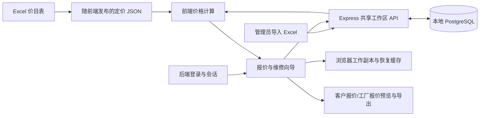
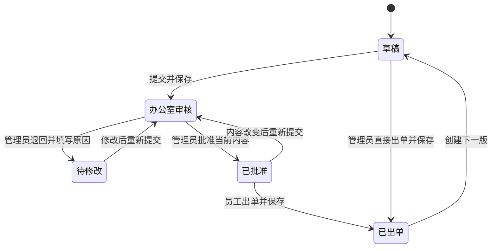

# 项目逻辑与当前实现

更新：2026-10-21。本次改动保留在本地。

## 1. 系统现在如何运行



**默认前端已接入后端 API。** 登录、报价、审核、照片、员工、公司资料与价目表使用共享 PostgreSQL 数据。不同浏览器连接同一个后端即可协作；旧浏览器数据保留，并提供管理员导入入口。
完整配置与接口见[本地共享后端接入](backend-integration-zh.md)。当前改动未推送或部署，GitHub Pages 线上版本尚未更新。

| 模块 | 当前职责 | 关键入口 |
| --- | --- | --- |
| 登录与员工 | 服务端哈希密码、可撤销会话、角色校验、员工启停 | `authContext.tsx`、`server/src/auth.ts` |
| 报价状态 | 客户、明细、颜色、金额、生命周期 | `quoteContext.tsx`、`quoteLifecycle.ts` |
| 产品与维修向导 | 位置、配置、产品、测量、附加项、确认 | `pages/quote-item/ItemWizard.tsx` |
| 定价 | 尺寸档位、配置、网材、附加费、GST、定金 | `priceLookup.ts`、`configuredPrice.ts`、`quoteTotals.ts` |
| 审核 | 提交、退回、重提、批准，校验提交内容是否变化 | `quoteReview.ts`、`reviewStore.ts`、`AdminReviews.tsx` |
| 归档与版本 | 同一报价编号的多个版本、评论、复制、成交状态 | `quoteArchive.ts`、`Quotes.tsx` |
| 打印 | 客户与工厂两种内容范围，PDF/图片生成 | `QuotePdfPreview.tsx`、`quotePrint.ts` |
| 后端 | 登录、共享工作区、审批权限、并发编号、版本校验与审计 | `server/src/workspace.ts`、`server/prisma/schema.prisma` |

表中的前端逻辑文件主要位于 `src/lib/`；页面位于 `src/pages/`，组件位于 `src/components/`。

## 2. 一张报价的完整路径

1. 登录后进入 Quotes，创建报价，填写客户、现场地址与账单地址。
2. 添加产品：`+ Add Opening` → 位置 → 配置 → 产品 → 测量 → Add-ons → 确认。
3. 添加维修：`+ Add Extra / Repair` → 维修描述、人工/服务价格与 Extras → 确认。
4. 工作区汇总明细、数量、颜色附加费、GST 和总额；可保存并预览客户/工厂报价。
5. 员工提交办公室审核。管理员可退回并填写原因，员工修改后重新提交；管理员批准后员工才能出单。
6. 出单后冻结价格与定金计算依据，并锁住明细和价格编辑。需要调整时创建下一版，保留原出单版本。
7. 同一报价还有独立的成交状态：进行中、已成交、放弃。成交或放弃后需要重新打开才能继续编辑。



“待修改”和“已批准”是审核记录的状态；对应报价的 `status` 仍是 `office-review`。
管理员保留直接出单能力。员工必须获得与当前内容一致的批准。

## 3. Add-ons、Extras 和价格的关系

- **Add-ons**：新产品附加配置，例如门锁、宠物门。新产品向导显示这类选项。
- **Extras**：维修或额外服务。维修入口显示这类选项，不展示新产品 Add-ons。
- **网材/配置附加价、安装附加费**：属于产品自身的定价构成，和维修入口不是同一概念。
- 尺寸根据配置换算，再向上匹配价目表的尺寸档位；无法报价的组合需要修正输入。
- 明细最终单价支持人工调整；`calculatedPrice` 保留计算值，`finalPrice`/`unitPrice` 用于实际报价。
- 总价包含明细数量、附加收费与报价级颜色费，随后计算 GST、定金和余额。
- 已出单报价使用出单时的金额快照，后续价目表或公司默认定金比例变化不改旧单金额。

## 4. 数据保存与审核规则

| 数据 | 目前存储位置 | 行为 |
| --- | --- | --- |
| 当前报价草稿 | 数据库＋浏览器工作副本 | 延迟同步；断网未发送编辑保留本地 |
| 保存的报价和修订 | PostgreSQL JSONB | 按编号和版本区分，原子写入并检查期望版本 |
| 审核、员工、会话、公司配置 | PostgreSQL | 所有业务请求校验会话和角色 |
| 房间及明细照片 | PostgreSQL | 不同浏览器读取同一份图像与说明 |
| 向导未完成输入 | 数据库＋本地工作副本 | 可继续、丢弃和恢复 |
| 管理员导入的价目表 | 数据库 | 其他浏览器同步；刷新后保留 |
| 商品目录 | PostgreSQL | 保留原目录表与只读接口 |

本次完善后的规则：

- 提交审核时保存的是 `office-review` 状态，同时保存审核记录和最初归属员工。
- 审核关联客户、地址、测量、明细、价格、GST、颜色费用和定金比例。变化后旧批准不能用于员工出单，管理员也不能批准已过期的提交内容。
- 付款记录和照片加载不影响商业内容审核。旧审核记录没有内容快照时，需要重新提交一次。
- 保存、提交、出单、修订或复制失败时，不再假装成功或跳转到不存在的副本。
- 共享写入采用数据库事务，带每条记录的版本校验；冲突和网络失败不会被当作保存成功。
- 标签页重新获得焦点或收到其他标签页存储变更时，刷新归档/审核信息；不会用归档覆盖正在编辑的草稿。

## 5. 本次完善范围

1. 补上员工出单的审批条件，并防止改价后继续使用旧批准。
2. 修复提交后归档状态仍是草稿，以及保存失败仍显示成功的问题；提交和审核决定增加写入失败回退。
   生命周期切换立即保存草稿，避免快速刷新回到旧状态；人工改价同步实际单价，避免重新打开后误判审核内容变化。
3. 复制报价生成新的显示编号，重新计算颜色附加费，保存失败不返回虚假编号；自动编号可从损坏计数恢复。
4. 后端异步接口统一接住错误；断库返回 JSON 503，未知错误返回 JSON 500，未知路径返回 JSON 404。
5. 新增 `/health/ready` 检查数据库；保留 `/health` 检查进程；退出时关闭 HTTP 服务和数据库连接。
6. 数据库种子初始化改成单次事务，非空库跳过，避免删除已有客户与报价。
7. 修正后端生产启动路径，并排除 Vite 无需轮询的大型缓存/测试目录，减少本地启动负担。
8. 更新启动文档并补充审核、保存失败和接口故障恢复测试。

## 6. 本地启动和验证

在仓库根目录安装前端：

```bash
npm ci
npm run dev -- --host 127.0.0.1 --port 5174
```

另开终端，准备数据库和后端（已有 `.env` 时保留原文件）：

```bash
docker compose up -d
cd server
cp -n .env.example .env
npm ci
npx prisma generate
npx prisma migrate deploy
npx prisma db seed
npm run bootstrap
npm run dev
```

前端：`http://localhost:5174`。后端：`http://localhost:3001`。
后端生产启动先执行 `npm run build`，再执行 `npm start`。

```bash
# 根目录
npm test
npm run build
npm run test:e2e
npm run test:server
# server/ 目录
npm test
curl http://localhost:3001/health/ready
```

本次测试使用 `package-lock.json` 锁定的 npm 依赖。旧 pnpm 链接目录已保留备份，并按 npm 锁文件重装；后续请使用 `npm ci`，避免混用依赖树。
在这台 WSL 机器上，Node 由 mise 管理；Windows Docker Desktop 需已启动。

## 7. 完整部署前的下一步

本地多人共享后端已接通。接下来是配置正式初始密码、数据库备份、Fly.io/Neon 与 HTTPS，并为前端配置同一个 API 地址和 CORS。当前尚未推送或部署。下面第一至三轮记录保留为历史，本轮实现以[后端接入文档](backend-integration-zh.md)为准。

## 8. 第一轮验证记录

- 前端：25 个单元测试文件、213 项测试通过；TypeScript 检查和生产构建通过。
- 浏览器：本次选择的 26 项测试通过，覆盖登录、退回/重提/批准、批准后改价、出单/修订、归档、复制颜色费、另存、存储失败及产品/维修测量。未运行全部端到端测试。
- 后端：构建与 8 项 HTTP 测试通过，覆盖断库、恢复、未知异常和不存在的接口。
- 本地数据库：重复运行种子初始化前后，对比 11 张表的全部记录，确认没有改变；就绪检查和四组目录接口返回 HTTP 200。
- 本次检查文件的 ESLint 无错误，`quoteContext.tsx` 仍有既有的组件/函数混合导出热更新警告。

## 9. 第二轮完善：照片、收费和标签页一致性

- **房间照片**：在报价工作区每个房间下补上上传、查看、备注和删除入口。切换报价不再删除上一张的缓存；先恢复图片，再写入缓存；重新打开同一编号、同一版本也会恢复图片。异步读取只补当前仍存在的照片，不恢复已删除照片，也不会覆盖新备注。
- **照片保存失败**：显示错误并提供 `Retry photo storage`，可保留内存里的照片后重试。IndexedDB 连接在操作结束后关闭；归档因容量不足省略图片时，保留照片编号和备注供缓存恢复。
- **离开页面保存**：在页面离开或刷新时立即保存当前草稿，减少 300 毫秒防抖窗口造成的最后几步修改丢失。
- **历史收费**：旧报价上不属于当前产品/维修入口、或已从价目表移除的收费，显示在 `Previously selected charges`，可明确移除；不会静默删除旧费用。安装附加费沿用原先捕获的价格，旧数据同时列在两个位置的同名收费只计算一次。
- **价格输入**：新选择的询价项必须明确输入金额，免费时可以明确输入 0；负数、无效金额或空白维修价格不能继续/保存。测量点、窗型或安装选项不同的明细不会仅因总价相同而合并。
- **公司设置**：校验定金比例、有效天数、手续费和颜色费；保存失败保留编辑，不再提示已保存。标签页同步最新设置，有未保存编辑时阻止旧表单覆盖其他标签页的新设置，并提供重新加载入口。
- **本地账号**：其他标签页的退出、账号停用和权限变化会刷新当前登录状态。损坏的员工/会话记录不再导致页面异常或重新启用默认账号；员工和登录保存失败会显示原因。

这些同步限于同一网站地址、同一浏览器。登录仍是本地演示实现，跨设备多人共享仍需第 7 节的后端工作。

第二轮验证：28 个单元测试文件、227 项测试通过；TypeScript 检查和生产构建通过。本轮选取的 26 项浏览器测试全部通过，包含照片刷新/切换/重试、历史收费移除、询价金额确认、设置冲突、账号停用同步及完整审核出单流程；未运行其余全部浏览器测试。

## 10. 第三轮完善：备份、编辑保护和出单资料快照

### 备份与恢复

入口：Quotes → **Backup, restore & local drafts**。

- `Download quote backup` 下载带格式版本的 JSON，包含保存的报价版本、本地工作副本、未完成的向导输入、审核、归属和可读取的照片。当前标签页未归档的报价内容也会纳入。
- 文件不包含员工密码或登录会话。本轮范围是报价数据；全局公司设置与临时导入的价目表不随文件恢复。已出单版本自身保存的公司资料快照包含在报价中。
- 选择文件后先显示恢复预览；点击 `Restore missing quotes and drafts` 才开始写入。已有同号同版本、已有非空工作副本和已有向导输入优先保留，不静默覆盖。
- 文件格式、版本、报价与照片结构验证失败会中止。恢复涉及的报价在其他标签页被编辑时会拒绝导入；写入失败会尝试回退本地记录和照片，不能完成回退时会明确提示保留备份重试。
- 恢复出的本地工作副本可以在该面板的 Local drafts 中继续打开。向导输入的恢复时间会更新，避免旧备份里的未完成输入被 30 天清理规则立即移除。
- 存档损坏时禁止把它当作空存档覆盖，并提供原始存档下载入口。正常备份可在干净浏览器中恢复；原始损坏文件供另行修复使用。

### 多标签页编辑保护

- 使用浏览器 Web Locks 为同一报价编号保留编辑权，覆盖该编号下的全部版本。第二个标签页显示只读；原标签页关闭或切换报价后，可点 `Edit in this tab` 读取最新草稿并申请编辑权。
- 不同报价可以同时编辑。归档、审核决定、评论、成交状态、复制、恢复和编号分配通过统一写锁串行处理，避免不同报价同时改写存档时互相丢记录。
- 草稿按报价编号和版本分开保存，每个标签页单独记录当前报价。旧的全局草稿键保留兼容用途，刷新优先恢复该标签页自己的报价。
- 未持有编辑权时不自动写入报价、照片或向导草稿；保存过程中内容发生变化时会拒绝提交过期内容。
- 保护限于同一浏览器、同一网站地址，且依赖 Web Locks 支持。跨设备并发仍需后端事务和版本检查。

### 已出单资料快照

- 新出单时深拷贝公司名称、ABN/QBCC、地址电话、银行资料、条款、有效天数、保修说明及相关链接，和已有金额快照一起保存。
- 客户/工厂文档优先使用该版本保存的资料，后续修改公司设置不会改写旧出单文档；新修订重新使用当前设置。
- 旧已出单版本没有这份资料快照时仍可查看，但会明确提示文档正在使用当前公司资料，不伪造历史内容。
- 快照保存的是生成文档所用资料，PDF 仍由前端重新渲染；本次没有实现服务端 PDF 文件归档。

开发说明：涉及写存档的 QuoteContext 方法现在返回 Promise，调用方必须等待成功再显示完成或读取存档。原有同步的 reducer 和纯数据计算函数保持同步。

第三轮验证：29 个单元测试文件、234 项测试通过；TypeScript 检查和生产构建通过。最终选取的 31 项浏览器测试全部通过，覆盖干净浏览器恢复、重复导入、无效文件、标签页只读与释放后编辑、不同报价并发保存、各标签页刷新恢复、出单文档冻结，以及既有审核、照片和存储失败流程。本轮检查文件 ESLint 无错误，保留既有热更新导出警告。
